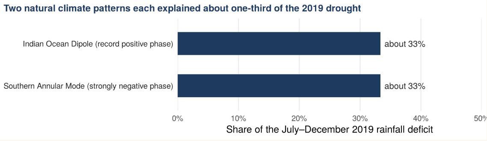

## The Horizon Is Turning Red: Framing the Black Summer Crisis {#sec-description}

During the 2019/20 Austral spring and summer, southeastern Australia experienced an unprecedented fire crisis known as the "Black Summer". Across the temperate forest ecosystems stretching throughout southeast Australia catastrophic bushfires burned over 19.4 million hectares of land. Dense smoke plumes shrouded major cities, elevating atmospheric fine particulate matter ($\text{PM}_{2.5}$) to hazardous levels and triggering a 34% spike in emergency room admissions for severe respiratory distress.
```{r}
#| echo: false
#| message: false
#| error: false
#| label: tbl-crisis-loss
#| tbl-cap: "Emergency Department & DISASTER PHILANTHROPY records. Source: van Oldenborgh et al. (2021)" 

library(tibble)
library(gt)
compound_crisis_tbl <- tribble(
  ~"Impact Dimension",        ~"Recorded Statistic",
  "Operational Domain",       "Southeastern Australia (29°S–40°S, 144°E–155°E)",
  "Total Area Burned",        "> 19.4 Million Hectares",
  "Direct Fatalities",        "34 Lives Lost",
  "Infrastructure Impact",    "~5,900 Structures Destroyed",
  "Public Health Acute Peak", "+34% Emergency Visits (Respiratory/Asthma)"
) |> gt() |> 
    tab_header(
    title = md("**THE 2019/20 COMPOUND CRISIS**"),
    subtitle = "Key impact metrics across southeastern Australia"
  )
# Display the table
compound_crisis_tbl 

```

The severity of the event was underpinned by compounding climatic extremes, impacted areas are shown in @tbl-crisis-loss [@Oldenborgh2021] along with recorded losses. The year 2019 recorded Australia's highest national mean annual temperature and lowest total rainfall since standardized instrumental recording began in 1910 and 1900, respectively. This multi-year rainfall deficit severely depleted deep-layer volumetric soil moisture and forest fuel moisture content prior to the peak fire season.

While fire is an ancient feature of the Australian continent, the sheer spatial extent, intensity, and early onset of the 2019/20 season challenged existing disaster management systems and raised a critical research question: 

**To what extent was the weather-induced risk of this extreme bushfire season exacerbated by anthropogenic climate change versus natural climate variability?**

Isolating this human signature requires evaluating meteorological drivers—specifically extreme heat, precipitation deficits, and composite fire weather indices—across the affected domain.

## Decoding the Signal in the Smoke

Separating the signal of human-induced warming from the background noise of natural climate variability requires a rigorous, multi-step extreme event attribution protocol. To evaluate weather-induced fire risk, atmospheric scientists look beyond single-day fire behavior and turn to physical proxies like the Canadian Fire Weather Index (FWI). By integrating daily surface air temperature, relative humidity, 10-meter wind speed, and antecedent precipitation, the 7-day maximum FWI ($\text{FWI7x-SM}$) tracks fuel moisture dynamics across multiple soil depth layers and demonstrates a strong log-linear relationship ($r^2$) with total area burned across southeastern Australian forests.

When evaluated using Generalized Extreme Value (GEV) distributions fitted against smoothed Global Mean Surface Temperature (GMST) anomalies, the data reveals a clear, compounding anthropogenic influence:

### Extreme Heat as the Primary Engine: 
The 7-day maximum temperature anomaly ($\text{TX7x}$) observed in December 2019 was $1^\circ\text{C}$ to $2^\circ\text{C}$ hotter than equivalent pre-industrial events. Anthropogenic warming increased the likelihood of a heatwave of this magnitude by at least a factor of 2 ($PR \ge 2$). Sensitivity analyses confirm that extreme heat was the single dominant factor driving elevated FWI values, followed by declining relative humidity.

### Attributable Increase in Fire Risk: 
Across 11 large climate model ensembles, human-induced climate change has elevated the probability of an $\text{FWI7x-SM}$ event as severe as 2019/20 by at least 30% ($PR \ge 1.3$) relative to 1900. ERA5 reanalysis data shows an even steeper historical trend ($PR \ge 4$), though short-term observational records reflect localized decadal drying.

### The Absence of a Long-Term Drought Trend:
Notably, neither long-term observations nor climate models show a statistically significant attributable anthropogenic trend in meteorological drought extremes—whether evaluated over annual scales or during the driest month of the fire season.

### The Overlaid Precondition of Natural Climate Modes:
Anthropogenic warming did not act in isolation. As shown in the @fig-dip-sam Approximately two-thirds of the acute July–December 2019 rainfall deficit was driven by a rare, concurrent alignment of two dominant internal variability modes: a record positive Indian Ocean Dipole (pIOD) and a strongly negative Southern Annular Mode (nSAM), both of which suppress precipitation across southeastern Australia.

::: {.no-border}
```{r}
#| echo: false
#| label: fig-dip-sam
#| fig-cap: "Approximate contributions of the Indian Ocean Dipole (~33%) and Southern Annular Mode (~33%) to the July–December 2019 rainfall deficit across southeastern Australia. Source: van Oldenborgh et al. (2021)"


```
:::

## Limitation of the analysis
A critical insight from the attribution analysis lies in systematic climate model deficiencies. Across the evaluated ensembles, models consistently overstate temperature variability ($\sigma/\mu$) while underestimating the magnitude of observed multi-decadal warming trends in extreme maximum temperatures. Because models under-simulate extreme heat trends, the multi-model consensus of a 30% increase in fire weather risk represents a highly conservative lower bound; the real-world anthropogenic contribution to Australia's burning skies is likely substantially higher.

## Living on a Changing Continent

Returning to the primary inquiry posed in the @sec-description, the 2019/20 "Black Summer" bushfire season was a compound extreme event where anthropogenic climate change and extreme natural variability converged. Human-induced global warming provided the thermodynamic fuel by doubling the likelihood of extreme heat waves and increasing overall fire weather risk by at least 30%. Simultaneously, natural climate modes (pIOD and nSAM) delivered the localized precipitation deficit.

### A new Common
Looking forward to a future climate $2^\circ\text{C}$ above pre-industrial levels, climate models project that fire weather conditions as severe as 2019/20 will become **at least 4 times more likely** (@Oldenborgh2021). While Australia maintains world-class emergency preparedness systems, rising baseline temperatures severely restrict the safe seasonal weather windows available to conduct prescribed hazard-reduction burning. Adapting to an increasingly flammable continent requires moving beyond historical baselines and acknowledging the growing human footprint on extreme climate events


## References
:::{#refs}

:::

The packages  *tibble* by @tibble and *gt* by @gt are used to make this blog.

*Enjoyed this analysis? Check out my [About Page](../../about.qmd) or follow me on [GitHub](https://github.com/adhi0021)!*
